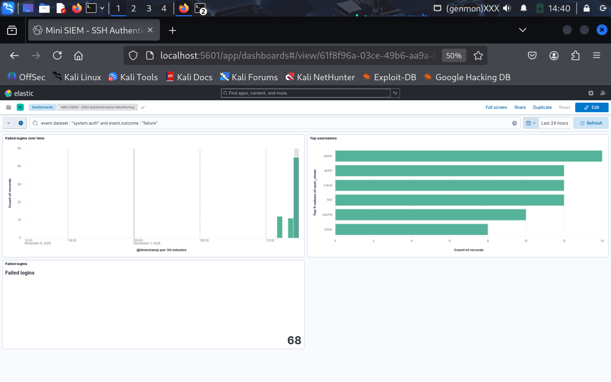
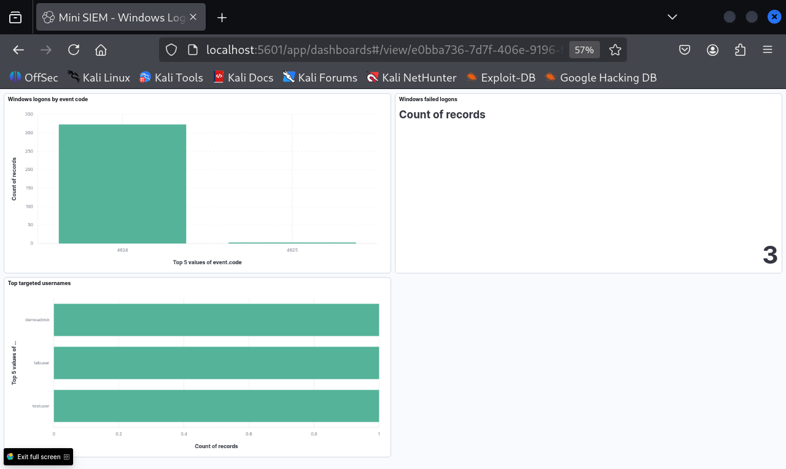

# Mini SIEM with Elastic Stack

A small SIEM lab: Linux SSH authentication logs and Windows logon events are collected, stored in Elasticsearch, and visualized in Kibana dashboards.

## Architecture

    Linux:   auth.log (Kali VM) -> Filebeat (system module) --\
                                                               +-> Elasticsearch -> Kibana
    Windows: Security log (host) -> Winlogbeat ---------------/

## Components

- Elasticsearch 8.15.3 (single node, 1 GB heap)
- Kibana 8.15.3
- Filebeat 8.15.3 with the system module (auth fileset)
- Winlogbeat 8.15.3 on the Windows host (Security log, event IDs 4624 and 4625 only)
- rsyslog and OpenSSH server on the Kali VM (source of auth.log)

The Elastic components run in Docker Compose inside one Kali VM. The VM uses VMware NAT networking. Windows sends events over the private VMware network.

## Dashboards

Linux SSH authentication:

Windows logon events:

Linux panels: failed logins over time, top usernames, total failed logins.
Windows panels: logons by event code (4624 success, 4625 failure), failed logons, top targeted usernames.

## Setup

Elasticsearch needs a higher memory-map limit:

    sudo sysctl -w vm.max_map_count=262144

Copy `.env.example` to `.env` and set `ES_BIND_IP` to the VM address on the private VMware network. If it is not set, Elasticsearch listens on 127.0.0.1 only. Never set it to 0.0.0.0.

Start the stack:

    docker compose up -d

Open Kibana from inside the VM at http://localhost:5601 and create data views `filebeat-*` and `winlogbeat-*` with timestamp field `@timestamp`.

### Windows

Install Winlogbeat 8.15.3 (verify the download against the published SHA512), then use `winlogbeat/winlogbeat.example.yml` as a starting point, replacing `<KALI_IP>` with the VM address. Install and start it as a Windows service.

## Generating test data

Linux: failed SSH logins against the local SSH service only (127.0.0.1):

    for u in admin root test oracle guest; do
      sshpass -p wrongpass ssh -o StrictHostKeyChecking=no -o PubkeyAuthentication=no -o ConnectTimeout=5 $u@127.0.0.1 true 2>/dev/null
    done

Windows: failed logons with non-existent usernames against the local machine (event 4625):

    net use \\127.0.0.1\IPC$ /user:labuser WrongPass123

## Finding: data quality issue

Some Linux usernames were stored with a leading space (for example " admin" and "admin" counted as two values), which split the counts in charts. I confirmed it with a terms aggregation in Elasticsearch and worked around it with a Kibana runtime field, `user_clean`, which applies `trim()` to `user.name`. I did not inspect the ingest pipeline itself, so the root cause is a hypothesis: different sshd message formats being parsed differently.

## Privacy

Windows Security events contain the computer name and account names. The Windows dashboard only uses event codes, counts, and the usernames of failed attempts generated for this lab. Raw events are not published.

## Limitations

- Lab setup only: Elastic security and TLS are disabled. Elasticsearch listens on the private VMware NAT address only, and Kibana on localhost only. Do not expose either to a network.
- One Linux host and one Windows host. Source IPs are local because the attempts were generated locally.
- No alerting rules yet.

## Next steps

- Add a brute-force detection rule
- Drop sensitive fields at the source with a drop_fields processor
- Enable Elastic security and TLS
- Export the dashboards as saved objects

## Disclaimer

For educational purposes only.
